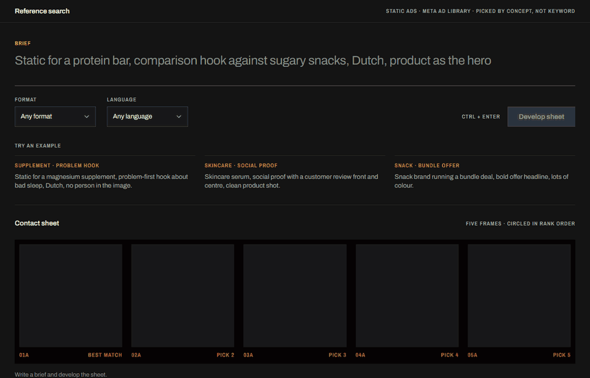
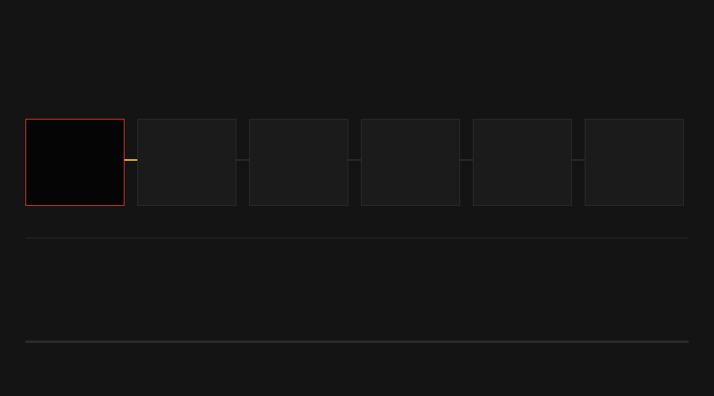
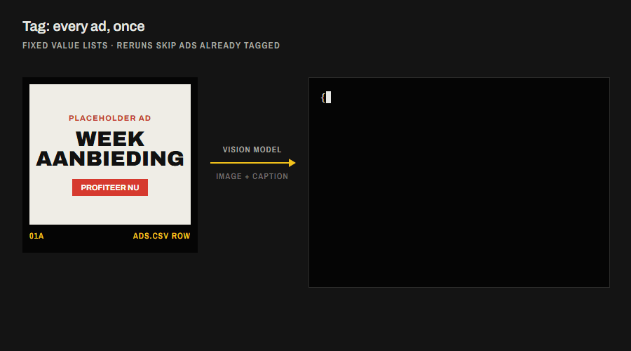
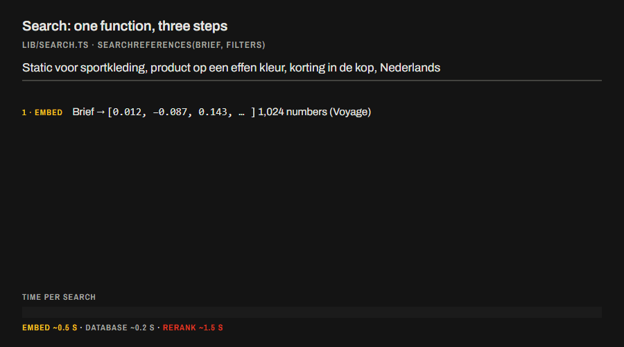
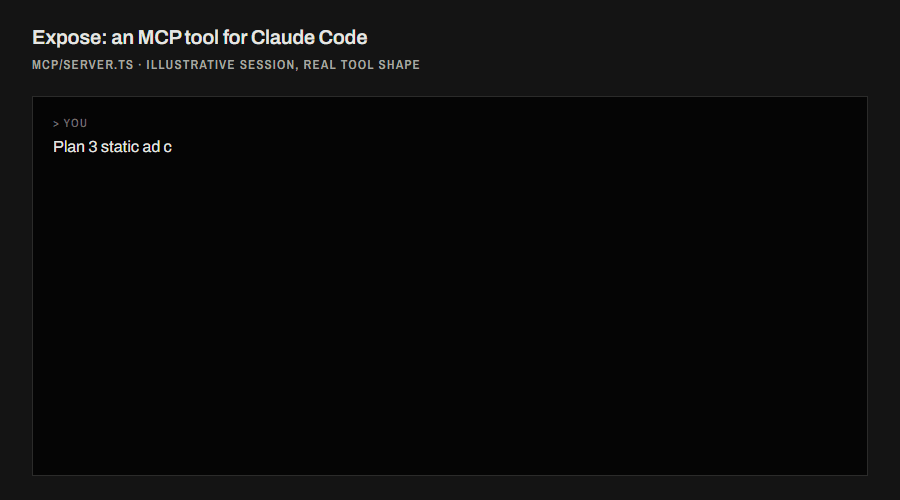
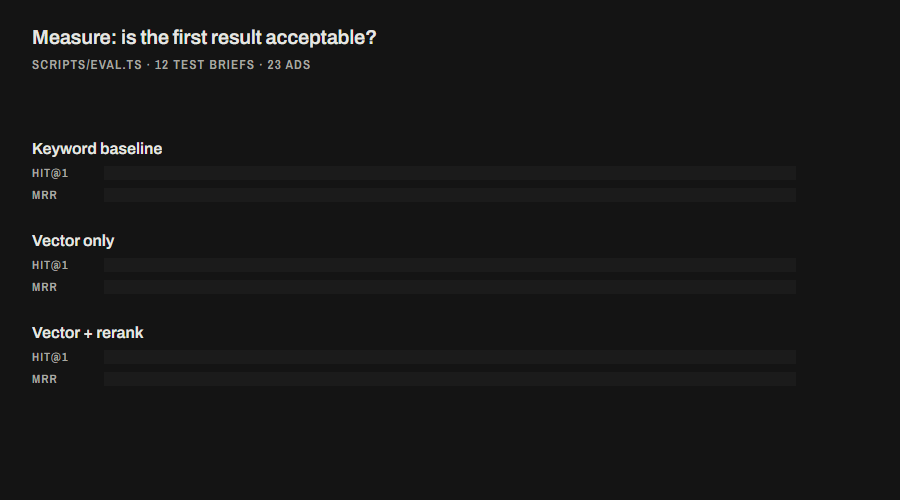

# Reference search

**Type a concept brief for a static ad. Get the five best reference ads from a tagged library, each with a one-line reason it fits.**

It works from a web page and as an MCP tool that Claude Code can call while it plans ad concepts.



<sub>The demo uses placeholder images. The real library is 23 public ads from the Meta Ad Library; they are other brands' creative work, so they are not published in this repo.</sub>

---

## Contents

- [Results](#results)
- [How it works](#how-it-works)
  - [1. Collect](#1-collect)
  - [2. Tag](#2-tag)
  - [3. Store](#3-store)
  - [4. Search](#4-search)
  - [5. Expose as an MCP tool](#5-expose-as-an-mcp-tool)
  - [6. Measure](#6-measure)
- [The web page](#the-web-page)
- [Getting started](#getting-started)
- [Commands](#commands)
- [Configuration](#configuration)
- [Project structure](#project-structure)
- [Free-tier limits and troubleshooting](#free-tier-limits-and-troubleshooting)
- [Tests](#tests)
- [Limits](#limits)
- [With real agency data, next](#with-real-agency-data-next)
- [How this was built](#how-this-was-built)

---

## Results

23 real static ads from 5 brands (Meta Ad Library, ads shown in the Netherlands), 12 test briefs.

| Variant | Hit@5 | Hit@1 | MRR |
|---|---|---|---|
| Keyword baseline (Postgres full-text) | 10/12 | 7/12 | 0.68 |
| Vector only | 12/12 | 11/12 | 0.96 |
| **Vector plus rerank** | **12/12** | **12/12** | **1.00** |

- **Meaning beats keywords.** Keyword search missed 2 briefs entirely and put an acceptable ad first only 7 times out of 12.
- **Hit@5 saturates on a library this small.** The top 5 is over a fifth of all ads, so both vector variants score 12/12. Hit@1 ("is the first result acceptable?") and MRR are where the variants separate.
- **Rerank's gain is small.** It fixed the one brief where vector order put the right ad second. With 12 briefs, that's one brief of evidence, not a proven improvement.

A typical search takes **2 to 4 seconds and about 4,200 tokens**: embed ~0.5 s, database ~0.2 s, rerank ~1.5 s.

---

## How it works



| Stage | What happens | Code |
|---|---|---|
| **1. Collect** | Public static ads from the Meta Ad Library, one row each in `data/ads.csv` | `data/ads/`, `data/ads.csv` |
| **2. Tag** | A vision model tags each ad once into fixed value lists | `scripts/tag.ts`, `lib/taxonomy.ts` |
| **3. Store** | Tags plus a 1,024-number embedding go into one Postgres table with pgvector | `scripts/load.ts`, `db/schema.sql` |
| **4. Search** | Embed the brief, take the 20 nearest ads, an LLM picks the best 5 with reasons | `lib/search.ts` |
| **5. Expose** | The same search as an MCP tool for Claude Code | `mcp/server.ts` |
| **6. Measure** | Hit@5, hit@1 and MRR on test briefs against a keyword baseline | `scripts/eval.ts` |

The web page, the MCP tool and the eval all call **one function**, `searchReferences()` in [`lib/search.ts`](lib/search.ts). There is one search to fix and one to explain.

**Stack:** Next.js 16 and TypeScript; Postgres on [Neon](https://neon.com) with [pgvector](https://github.com/pgvector/pgvector); [Voyage AI](https://www.voyageai.com) `voyage-3.5` embeddings; Google Gemini (free tier, default) or Anthropic Claude for tagging and reranking; the official MCP TypeScript SDK.

### 1. Collect

The library is a folder of images plus one CSV row per ad. Each row records where the ad came from and how long it ran:

| Column | Example | Notes |
|---|---|---|
| `id` | `gymshark-03` | Brand plus a number; matches the image file name |
| `brand` | `Gymshark` | |
| `category` | `apparel` | `supplements`, `skincare`, `food_and_drink`, `apparel` |
| `image_path` | `data/ads/gymshark-03.jpg` | PNG, JPEG, WebP or GIF |
| `ad_library_url` | `https://www.facebook.com/ads/library/?id=…` | Link to the original ad |
| `started_on` | `2025-11-16` | "Started running on" date |
| `ended_on` | `2025-11-27` | Empty while the ad is still running |
| `primary_text` | `"Bespaar tot 50% op…"` | The caption above the image |

`started_on` and `ended_on` give **days running** (end, or today, minus start), which the tool shows as a rough winner signal: brands keep ads running when they work. It is labelled as a proxy everywhere, because it isn't proof. See [`data/ads.example.csv`](data/ads.example.csv).

The images, `ads.csv` and the tag files are gitignored: they're other brands' creative, so they stay on the machine that collected them.

### 2. Tag



`npm run tag` sends each image plus its caption to a vision model **once** and saves one JSON file per ad in `data/tags/`. Reruns skip ads that already have a file, so they cost nothing.

**Fixed value lists matter more than a clever prompt.** Filters and the eval only work if "testimonial" is always spelled `testimonial`. Every enum field is limited to these values ([`lib/taxonomy.ts`](lib/taxonomy.ts)):

| Field | Allowed values |
|---|---|
| `hook_type` | `problem`, `benefit`, `social_proof`, `offer`, `curiosity`, `comparison`, `founder_story` |
| `format` | `product_on_color`, `lifestyle`, `ugc_screenshot`, `testimonial`, `before_after`, `comparison_table`, `text_only`, `collage` |
| `offer` | `none`, `discount`, `bundle`, `free_shipping`, `trial`, `gift` |
| `product_visibility` | `none`, `small`, `hero` |
| `text_density` | `low`, `medium`, `high` |
| `has_person` | `true`, `false` |
| `language` | `nl`, `en`, `other` |

Plus three free-text fields: `headline_text` (on-image text, copied exactly), `angle` (one sentence: the argument the ad makes) and `summary` (two sentences: what it shows and how it's laid out).

The prompt has four rules: use only the listed values; copy on-image text exactly; describe what's visible, don't guess performance; write `angle` and `summary` in English even for Dutch ads, so search works across languages.

How the output stays clean:

1. The model is forced into a **JSON schema** (structured output), generated from the zod schema.
2. Every answer is **validated again with zod** before it's saved; a failed call is retried once.
3. Before any API call, each image's **first bytes are checked**: empty files, saved web pages and WebP-saved-as-`.png` are caught, and the true image type is sent.

### 3. Store

One table holds everything ([`db/schema.sql`](db/schema.sql)): the CSV fields, the tags as plain columns, one `search_text` field and its embedding.

```sql
create table ads (
  id text primary key, brand text, category text, image_path text,
  ad_library_url text, started_on date, ended_on date, primary_text text,
  hook_type text, format text, offer text, product_visibility text,
  text_density text, has_person boolean, language text,
  headline_text text, angle text, summary text,
  search_text text,
  tsv tsvector generated always as (to_tsvector('simple', coalesce(search_text, ''))) stored,
  embedding vector(1024)
);
```

`npm run load` creates the table, builds `search_text` from the angle, summary, headline, caption and the tag values written as words ("social proof hook, product on color format…"), embeds it with Voyage (as a *document*), and upserts every row. It also copies the images into `public/ads/` so the page can show them.

- **Why Postgres and not a vector database?** It's the database the agency already runs, and filters plus vector search fit in one SQL query.
- **Why no vector index?** 23 rows scan instantly. At 6,469 ads you'd add one line: `create index on ads using hnsw (embedding vector_cosine_ops);`.
- The `tsv` column exists only for the keyword baseline in the eval.

### 4. Search



`searchReferences(brief, { format?, language?, limit? })` does three things:

1. **Embed the brief** with the same Voyage model, as a *query*. Voyage adds a different instruction for queries and documents, which improves retrieval.
2. **Fetch 20 candidates** from Postgres by cosine distance. Filters apply only when passed:

   ```sql
   select …, coalesce(ended_on, current_date) - started_on as days_running,
          1 - (embedding <=> $1::vector) as similarity
   from ads
   where ($2::text is null or format = $2) and ($3::text is null or language = $3)
   order by embedding <=> $1::vector
   limit 20;
   ```

3. **Rerank:** the brief and the 20 candidates (tags, angle, summary, headline, days running) go to the LLM, which returns the best 5 with a one-line reason each. Its rules:
   - judge fit on the brief's hook, format and angle, not the product category alone;
   - at most 2 ads per brand, so results stay varied;
   - use days running only to break ties, and say so when it does;
   - write a concrete reason ("Dutch 20% korting headline over a flat orange product shot"), and name a mismatch when the fit is partial.

**The code enforces those rules itself** ([`lib/rerank.ts`](lib/rerank.ts)): ids the model invented are dropped, duplicates and over-cap brands are removed, and if fewer than 5 remain, the list is backfilled in vector order with an honest reason ("close match by embedding similarity, not picked by the reranker").

**Why two stages:** vector search is fast but blunt; the LLM is smart but slower and costs tokens. Vectors narrow the library to 20, and the LLM judges only those 20. That holds whether the library has 23 ads or 6,469.

Every search logs its time and token count to stderr and returns them to the page.

### 5. Expose as an MCP tool



<sub>Illustration of a session. The tool name, inputs and result shape are the real ones.</sub>

[`mcp/server.ts`](mcp/server.ts) is a small local MCP server (stdio transport) with one tool, `search_references`:

| Input | Type | |
|---|---|---|
| `concept` | string, required | The ad concept in plain language |
| `format` | enum, optional | Only return ads in this format |
| `language` | `nl` / `en` / `other`, optional | Only return ads in this language |
| `limit` | 1–10, optional | Default 5 |

It returns, per ad: `id`, `brand`, `reason`, the tags, `headline_text`, `angle`, `days_running` and `ad_library_url`. The tool description tells the agent *when* to call it: after it has a concept (hook, angle, format), before it describes the layout.

Register it with Claude Code from the project folder, then check it with `/mcp`:

```bash
claude mcp add --transport stdio refsearch -- npx tsx mcp/server.ts
```

Two details that usually go wrong with stdio servers are handled: nothing is printed to stdout (logs go to stderr), and the server loads `.env.local` itself, from its own path rather than the working directory.

### 6. Measure



[`data/eval.json`](data/eval.json) holds 12 briefs written the way a strategist would, each with 1 to 3 acceptable ads. The briefs avoid the tag words, so keyword search can't win by echoing them. The acceptable ads were picked by looking at the library, **before** running any search on that brief.

```json
[
  {
    "brief": "Loud weekly deal announcement in Dutch, all typography, no product photo, one clear button.",
    "acceptable": ["xxlnutrition-01"]
  }
]
```

`npm run eval` runs every brief through three variants:

| Variant | What it runs |
|---|---|
| Keyword baseline | Postgres full-text search on `tsv` (OR of the brief's words), top 5 |
| Vector only | Top 5 by embedding distance |
| Vector plus rerank | The full `searchReferences` |

It reports three metrics:

- **Hit@5:** share of briefs with at least one acceptable ad in the top 5.
- **Hit@1:** share where the *first* result is acceptable.
- **MRR** (mean reciprocal rank): 1 / rank of the first acceptable ad, averaged; 1.00 means it was always first.

Each brief is embedded once and reused by both vector variants, spaced to fit Voyage's free rate limit. Full per-brief rankings are written to `data/eval-results.json`.

---

## The web page

The page ([`app/page.tsx`](app/page.tsx)) is designed as a **darkroom contact sheet**: picking references is a picture edit.

- The brief is written on the sheet's slate. Format and language filters are optional, and three example briefs start a demo with one click.
- **Develop sheet** sends the brief to [`/api/search`](app/api/search/route.ts). The five frames develop from blank to image, then a red grease pencil circles each pick and writes its rank, in order.
- Each frame shows the ad in a black film border, with amber edge print for the frame number and days live. Below it: brand, the one-line reason, tags, and a link to the original in the Ad Library.
- The meta line shows the search time, the token count, and that **days live is a rough proxy, not performance**.
- Hovering a frame raises a loupe. With reduced motion, everything appears at once.
- Empty, loading, no-results and error states are all designed. Errors name the problem: a missing key, an empty library, or a rate limit.

The design was made with the Impeccable and UI/UX Pro Max skills and checked twice by an independent design reviewer. Product facts live in [`PRODUCT.md`](PRODUCT.md) and the design system in [`DESIGN.md`](DESIGN.md).

---

## Getting started

### Prerequisites

- Node.js 20+ (built on Node 24)
- A **Neon** project: neon.tech → create a project → **Connect** → copy the connection string. pgvector is available on every plan; `npm run load` enables it.
- A **Voyage AI** key: dashboard.voyageai.com → API keys. New accounts get 200M free tokens for the voyage-3 series. Add a payment method to lift the 3-requests-per-minute limit; the free tokens still apply.
- An **LLM key**, one of:
  - **Google Gemini** (free tier, default): aistudio.google.com → Get API key.
  - **Anthropic Claude**: console.anthropic.com → API keys.

### Setup

```bash
npm install
cp .env.example .env.local      # fill in DATABASE_URL, VOYAGE_API_KEY, GEMINI_API_KEY
npm run check                   # confirms Neon, Voyage and the LLM all answer
```

### Build the library

1. Save static ad images into `data/ads/` and add one row per ad to `data/ads.csv` (see [`data/ads.example.csv`](data/ads.example.csv)).
2. Tag and load:

   ```bash
   npm run tag     # vision tags -> data/tags/<id>.json (skips ads already tagged)
   npm run load    # creates the table, embeds, upserts, copies images to public/ads/
   ```

3. Search:

   ```bash
   npm run try -- "Static for a protein shake, benefit-led headline, Dutch"
   npm run dev     # http://localhost:3000
   ```

4. Measure:

   ```bash
   npm run eval    # needs data/eval.json (see data/eval.example.json)
   ```

---

## Commands

| Command | What it does |
|---|---|
| `npm run dev` | Web page on http://localhost:3000 |
| `npm run check` | Tests the Neon, Voyage and LLM connections, without printing keys |
| `npm run tag` | Tags untagged ads with the vision model |
| `npm run load` | Creates or migrates the table, embeds and upserts every tagged ad |
| `npm run try` | Prints the top 5 for sample briefs, or for one you pass |
| `npm run eval` | Hit@5, hit@1 and MRR for three variants |
| `npm run mcp` | Starts the MCP server on stdio |
| `npm test` | Unit tests (no keys needed) |
| `npm run typecheck` / `npm run lint` | TypeScript and ESLint |
| `npm run build` / `npm start` | Production build and server |

---

## Configuration

All settings live in `.env.local` (never committed). See [`.env.example`](.env.example).

| Variable | Required | Default | |
|---|---|---|---|
| `DATABASE_URL` | yes | | Neon connection string |
| `VOYAGE_API_KEY` | yes | | Voyage embeddings |
| `GEMINI_API_KEY` | one LLM key | | Google Gemini |
| `ANTHROPIC_API_KEY` | one LLM key | | Anthropic Claude |
| `LLM_PROVIDER` | no | whichever key is set, Gemini first | `gemini` or `anthropic` |
| `GEMINI_MODEL` | no | `gemini-3.5-flash-lite` | Pinned, not an alias |
| `ANTHROPIC_MODEL` | no | `claude-opus-5-5` | |
| `VOYAGE_MODEL` | no | `voyage-3.5` | Must output 1,024 dimensions |

If a required setting is missing, the page and the API name exactly which one.

---

## Project structure

```
app/
  page.tsx               the search page (contact sheet)
  api/search/route.ts    POST /api/search: validates input, calls searchReferences
lib/
  search.ts              searchReferences, vector-only and keyword variants
  rerank.ts              rerank prompt and the rules the code enforces
  llm.ts                 provider-neutral callJson (Gemini or Claude)
  gemini.ts / claude.ts  the two LLM clients (JSON schema output, retries)
  embed.ts               Voyage embeddings (with rate-limit retry)
  taxonomy.ts            fixed value lists and the tag schema
  ads.ts                 CSV parsing and image checks
  searchText.ts          the embedded text and the keyword query
  metrics.ts             hit@k, first-hit rank, MRR
  config.ts / db.ts      settings check and the Neon driver
scripts/                 tag, load, try, eval, check
mcp/server.ts            the MCP tool
db/schema.sql            the one table
data/                    examples are committed; ads, CSV and tags stay local
tests/                   unit tests (vitest)
docs/media/              the GIFs in this README
```

---

## Free-tier limits and troubleshooting

| Symptom | Cause | Fix |
|---|---|---|
| "Voyage rate limit reached" | No payment method: 3 requests a minute | Wait a minute, or add a payment method (free tokens still apply) |
| "Gemini quota for … is used up" | The free daily quota for that model is gone | Set `GEMINI_MODEL` to another model, or try tomorrow. The client never waits hours. |
| "Search isn't set up yet: … missing" | A key isn't in `.env.local` | Add it and restart the server |
| "The ad library is empty" | No table or no rows yet | Run `npm run tag`, then `npm run load` |
| "… is empty (0 bytes)" while tagging | The image file didn't save | Save the image itself again, not the page |

---

## Tests

```bash
npm test
```

24 unit tests cover everything that doesn't need a key: CSV parsing and date validation, image-type detection, the tag schema and the Gemini schema conversion, the search text and keyword query, the rerank rules (unknown ids, duplicates, brand cap, backfill), the metrics, provider selection, retry delays and the settings messages.

---

## Limits

- **Small library:** 23 ads from 5 brands, all statics, and no skincare yet.
- **Smoke-test eval:** 12 briefs, AI-drafted and reviewed by one person; it isn't a benchmark.
- **Days running is a proxy** for performance, not real results.
- **Video ads are out of scope;** they would need sampled frames plus a transcript.

## With real agency data, next

- Real spend and results replace days running as the winner signal.
- Every ad carries its briefing id, so the system learns which ideas win.
- The references strategists actually picked become the eval set.
- At 6,469 ads: an HNSW index; tagging stays a one-time batch; the rerank still sees only 20 candidates.

---

## How this was built

Built in a weekend as a demo, pairing with Claude Code. The AI wrote most of the code. The product and stack choices were made and reviewed by hand: Voyage embeddings, Postgres on Neon, real Next.js instead of a Vite-based copy, Gemini's free tier, the contact-sheet design, and the eval set. The eval briefs were drafted with AI help by looking at the ads, then reviewed by me.
